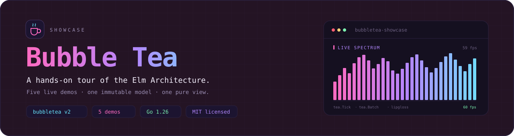
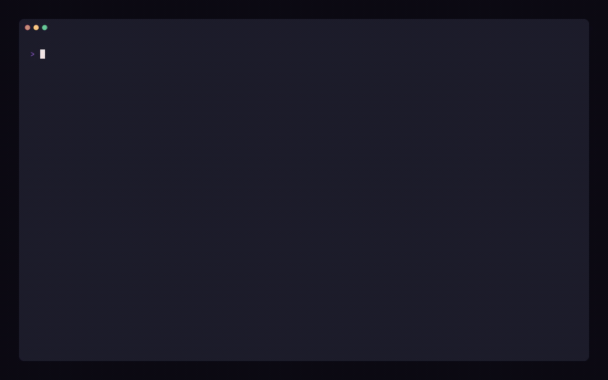
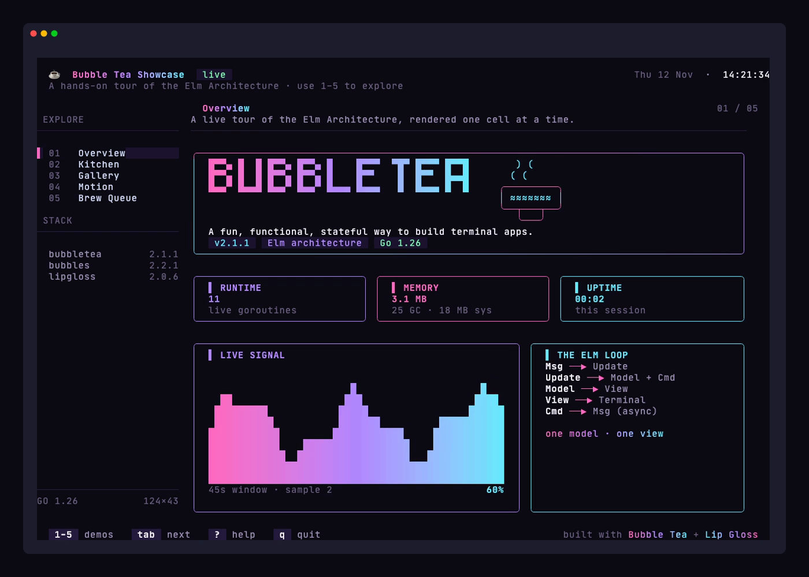
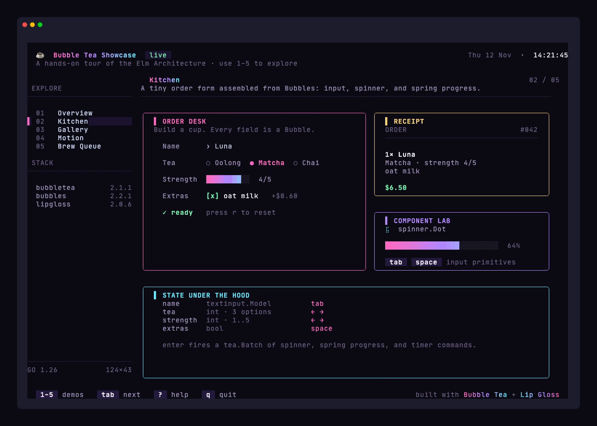
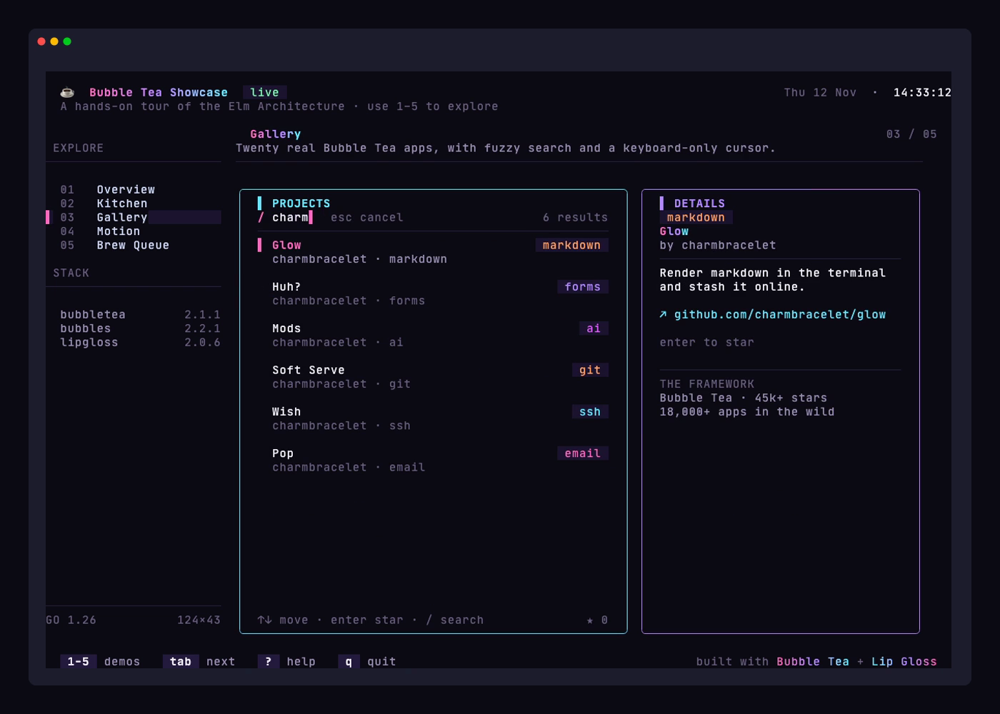
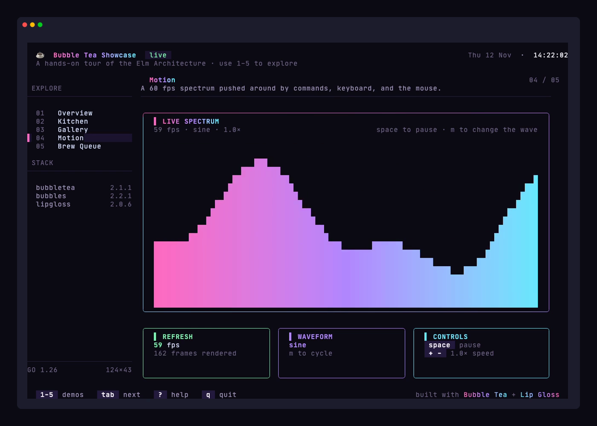
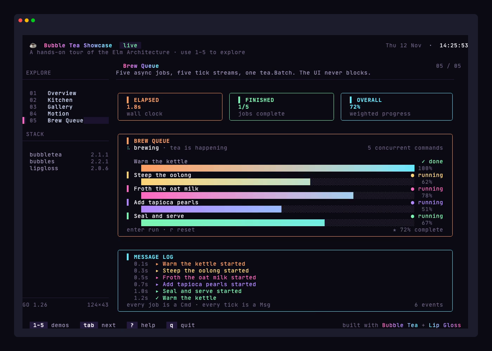

<div align="center">
  

  <p><strong>A hands-on tour of the Elm Architecture, rendered one cell at a time.</strong></p>

  <p>
    <a href="https://github.com/xeronith/bubbletea-showcase/actions/workflows/ci.yml"></a>
    <a href="https://pkg.go.dev/github.com/xeronith/bubbletea-showcase"></a>
    
    <a href="https://github.com/charmbracelet/bubbletea"></a>
    <a href="LICENSE"></a>
  </p>
</div>

---

**Bubble Tea Showcase** is a small, polished Go application that demonstrates the patterns behind [Bubble Tea v2](https://github.com/charmbracelet/bubbletea): one immutable model, a pure `View`, side effects as `Cmd`s, and a UI that responds to every terminal cell.

It is part reference implementation, part playground. Five interactive demos live inside a single responsive shell, with no network calls and no terminal escape trickery that you cannot read in the source.



## Why this exists

Bubble Tea is built on a deceptively small idea: **`Update` turns a `Msg` and a `Model` into a new `Model` and an optional `Cmd`.** Everything else — spinners, timers, HTTP calls, animations, concurrent jobs — is a consequence of that loop.

This repository turns that idea into a tour you can run and read:

- **Five self-contained demos** that each exercise a different part of the framework.
- **A real shell** with responsive layout, mouse support, focus routing, and a help overlay.
- **A tiny design system** built with Lip Gloss: gradients, cards, meters, area charts, and a wordmark.
- **Tests and a demo recording** so the patterns stay honest.

## The tour

| # | Page | What it demonstrates | Built with |
| :-: | :--- | :--- | :--- |
| `1` | **Overview** | Live process stats, an animated area chart, and a rotating clock — all driven by commands. | `tea.Tick`, `runtime.MemStats`, Lip Gloss |
| `2` | **Kitchen** | A focused order form with validation, a spinner, and a spring-animated progress bar. | Bubbles `textinput`, `spinner`, `progress` |
| `3` | **Gallery** | A fuzzy-filtered catalog of real Bubble Tea apps, a keyboard cursor, and starring. | Custom filter, Lip Gloss, keyboard state |
| `4` | **Motion** | A 60 fps spectrum that responds to the keyboard and the mouse. | `tea.Tick`, `tea.MouseMsg`, easing |
| `5` | **Brew Queue** | Five concurrent jobs, five tick streams, one `tea.Batch`, and a live message log. | `tea.Batch`, async `Cmd`s, progress |

The shell itself is the sixth demo: numbered navigation, `tab` / `shift+tab`, a collapsible sidebar below 96 columns, and a friendly "your terminal is too small" screen below **76 × 24**.

## Quick start

```bash
git clone https://github.com/xeronith/bubbletea-showcase.git
cd bubbletea-showcase
go run ./cmd/showcase
```

Or install it:

```bash
go install github.com/xeronith/bubbletea-showcase/cmd/showcase@latest
showcase
```

**Requirements:** Go **1.26+** and a terminal at least **76 × 24** — **120 × 40** is where the layout really breathes. Truecolor is recommended; Lip Gloss downsamples gracefully on smaller palettes.

## Controls

| Context | Keys | Action |
| :--- | :--- | :--- |
| **Global** | `1` – `5` | Jump to a demo |
| | `tab` / `shift+tab` | Next / previous demo |
| | `?` | Toggle the keyboard-shortcut card |
| | `q` / `ctrl+c` | Quit |
| **Kitchen** | `tab` / `shift+tab` | Move between fields |
| | `←` `→` | Change tea or strength |
| | `space` | Toggle oat milk |
| | `enter` | Brew (or advance a field) |
| | `r` | Reset the form |
| **Gallery** | `↑` `↓` / `j` `k` | Move the cursor |
| | `/` | Start a fuzzy search |
| | `enter` | Star / unstar a project |
| | `esc` | Clear the search |
| **Motion** | `space` | Pause the wave |
| | `m` | Cycle sine / ripple / noise |
| | `+` `-` | Adjust speed |
| **Brew Queue** | `enter` | Run all jobs again |
| | `r` | Reset the queue |

You can also click sidebar items and move the mouse over the Motion page. Everything flows through the same `Update` function.

## Screenshots

| Overview | Kitchen |
| :---: | :---: |
|  |  |

| Gallery | Motion |
| :---: | :---: |
|  |  |

<div align="center">
  
</div>

## How it works

Bubble Tea apps are a loop:

```text
        Msg
         │
         ▼
   ┌───────────┐   Cmd
   │  Update   │─────────▶ I/O
   └─────┬─────┘
         │ Model
         ▼
   ┌───────────┐
   │   View    │
   └───────────┘
```

- The **shell** owns the chrome, page routing, mouse hit-testing, and the help overlay.
- Each **page** is an independent model behind a small interface. Only the visible page receives messages; `OnShow` and `OnHide` start and stop animation loops.
- The **kitchen** turns a form into a `tea.Batch` of spinner ticks, a spring progress animation, and a timer command.
- The **queue** fans out five asynchronous tick streams. Each `jobTickMsg` updates one job; the UI never blocks.
- The **motion** page renders a 60 fps spectrum from a `tea.Tick` loop, smoothing values between frames and blending a gradient across the bars.

```go
// internal/pages/page.go
type Page interface {
	Title() string
	Subtitle() string
	Init() tea.Cmd
	OnShow() tea.Cmd
	OnHide()
	Update(tea.Msg) tea.Cmd
	View(width, height int) string
	Editing() bool
}
```

### Project layout

```text
.
├── cmd/showcase/         # entrypoint, flags, and version
├── internal/
│   ├── app/              # shell: chrome, routing, mouse, help
│   ├── pages/            # five independent demo models
│   └── ui/               # palette, gradients, cards, charts
├── demo/showcase.tape    # VHS recording script
├── demo/showcase.gif     # the tour above
├── docs/                 # banner and screenshots
└── .github/workflows/    # CI and releases
```

## Built with

| Library | Role |
| :--- | :--- |
| [**Bubble Tea v2**](https://github.com/charmbracelet/bubbletea) | The Elm Architecture runtime and terminal renderer |
| [**Bubbles v2**](https://github.com/charmbracelet/bubbles) | Text input, spinner, and spring progress components |
| [**Lip Gloss v2**](https://github.com/charmbracelet/lipgloss) | Layout, color, gradients, and borders |
| [**Go 1.26**](https://go.dev) | Generics, `min`/`max`, and a fast standard library |

## Development

```bash
make run      # go run ./cmd/showcase
make test     # go test ./...
make lint     # go vet + gofmt check
make build    # optimized binary in bin/showcase
make demo     # re-record demo/showcase.gif with VHS
```

`make demo` requires [VHS](https://github.com/charmbracelet/vhs), `ttyd`, and `ffmpeg`. The committed screenshots were captured with VHS from the same build.

### Tests

The suite covers the shell's navigation and input routing, page state transitions, fuzzy search, the async queue, the motion math, and exact Lip Gloss sizing:

```bash
go test -race ./...
```

## Contributing

Issues and pull requests are welcome. Please keep commits in [Conventional Commits](https://www.conventionalcommits.org/) style (`feat:`, `fix:`, `docs:`, `test:`, `chore:`), run `make check`, and add a test when a behavior changes. See [CONTRIBUTING.md](CONTRIBUTING.md) for the short version.

## License

[MIT](LICENSE) © 2026 Xeronith

---

<div align="center">
  <sub>Built with <a href="https://charm.sh">Charm</a>, a cup of tea, and an unreasonable affection for the alternate screen.</sub>
</div>
